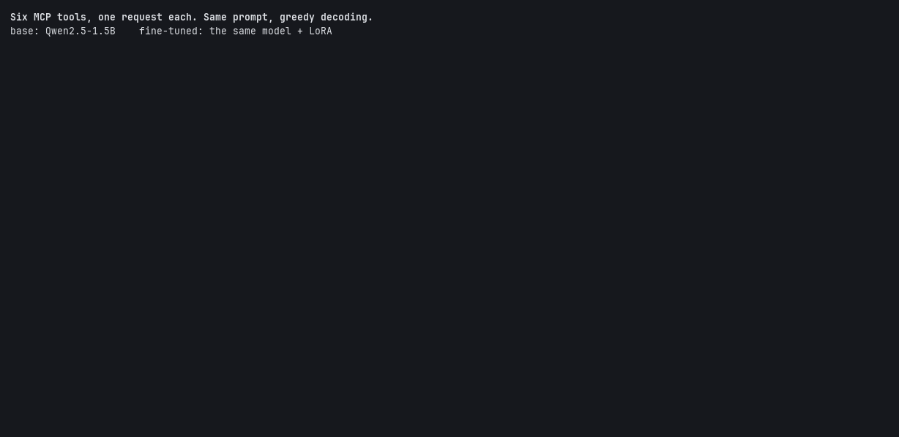

# toolcall-ft

**Can a small open model call MCP tools as reliably as a large one?**
This repository fine-tunes a 1–3B model to call the tools of two real MCP
servers, and judges every call with the same code those servers run.

- **The tools** are those of [cMCP](https://github.com/Simon-oid/cMCP)'s reference servers: `crag-mcp`
  (`crag_search`, `crag_stats`, retrieval over a [cRAG](https://github.com/Simon-oid/cRAG)
  index) and `filesystem-mcp` (`fs_list`, `fs_read`, `fs_stat`, `fs_write`, inside a
  sandbox).
- **The judge** is cMCP's own JSON parser and JSON Schema validator, linked from C
  ([`judge/judge.c`](judge/judge.c)). A call that passes it is a call the server would
  accept. A call that fails it fails for the reason the server would give, such as
  `/limit: minimum` or `/top: additionalProperties`.



**Result: after LoRA fine-tuning, the 1.5B model makes the right call as often
as the 7B and knows much better when not to call.**

| | right call, held-out phrasings | right call, hand-written (2 sets) | abstains when it should, held-out |
|---|---|---|---|
| Qwen2.5-1.5B base | 0.70 [0.63, 0.76] | 0.69 · 0.84 | 0.55 |
| Qwen2.5-7B base | 0.90 [0.86, 0.94] | 0.87 · 0.91 | 0.60 |
| **Qwen2.5-1.5B + LoRA (v2)** | **0.92** [0.88, 0.96] | **0.95 · 0.91** | **0.99** |

How these were measured:
- every model runs as GGUF on llama.cpp, free greedy decoding;
- the intervals are 95% bootstrap;
- the hand-written sets have 54 and 48 cases, so their intervals are wide.

Details, paired tests and failures are in [Fine-tuning](#fine-tuning).
Every number here comes from a script, with its hardware and date.

## How a call is scored

Each level counts only if the ones before it passed:

| Level | Passes when | Decided by |
|---|---|---|
| 1 json | the call parses to `{"name": string, "arguments": object}` | cMCP's parser (C) |
| 2 schema | the tool exists and its arguments pass the tool's `inputSchema` | cMCP's validator (C) |
| 3 tool | it is the tool the request needs | the expected call |
| 4 args | every argument matches, and none is added | the expected call |

Level 4 is "the call is right".

**How arguments are matched.** Each case says how:
- `exact` by default, where `1`, `1.0` and `true` are all different, since the
  schema says integer;
- `any_of` for equivalent forms (`notes`, `notes/`, `./notes`; the server takes
  all three);
- `contains_all` for free text. A search query has no single right spelling,
  but it must carry the words the user asked about.

**Optional arguments.** An argument the request leaves to the server's default
(`k` for search, `offset` for "the first 20 lines") may be omitted, but not
given a wrong value.

**Requests that need no call** are scored on whether the model abstains:
- a general question (`no_tool`);
- an operation no tool does, like delete or email (`unsupported`);
- a request missing what the tool needs, like "Read the file." (`ambiguous`),
  where the right move is to ask.

## The dataset

Generated from intents × phrasing families × slot values, with a fixed seed
([`src/toolcall/data.py`](src/toolcall/data.py)):

| Split | Cases | Phrasing | Slot values (files, folders, topics, contents) |
|---|---|---|---|
| train | 1499 | families 0–5 | train pools |
| val | 181 | families 0–5 | train pools |
| test_id | 180 | families 0–5 | test pools, never seen in training |
| test_ood | 315 | families 6–7, held out | test pools |

`test_id` asks whether the model learned the task or memorised the names.
`test_ood` asks whether it learned the task or memorised the phrasings.

There are 9 intents (6 tools and 3 kinds of no-call), all present in every
split. The expected call is built from the slots, so it is right by
construction. The tests check it anyway:
- every training call passes cMCP's validator and scores 4/4 against its own
  case;
- no test request or test value appears in training;
- a sample of the `fs_*` calls runs on the real `filesystem-mcp` over a
  fixture tree without a tool error.

Training targets for calls use Qwen 2.5's `<tool_call>` markup. For no-call
cases they are:
- **`unsupported`:** a fixed sentence saying which operation no tool does;
- **`ambiguous`:** a fixed clarifying question;
- **`no_tool`:** the base model's own answer, generated before training, so
  training teaches *when* to call without rewriting how the model talks.

## Baselines

All models run through a llama.cpp server on the same machine (RX 7800 XT,
llama.cpp `a4d4f2f`, 2026-11-10). The prompt is rendered by the model's own
chat template with the six tools, and decoding is greedy. Each server has one
slot and gets one request at a time: two identical runs over the 474 test
cases gave **0** different replies, so a difference between rows is the
model, not noise. Full table with intervals:
[`results/summary.md`](results/summary.md).

The three decodings:
- **free:** the raw reply, judged as written;
- **eager:** the whole reply constrained to "a valid call or `{"name": "none"}`";
- **lazy:** llama.cpp's own tool path, a grammar built from the tools' schemas
  and applied only once the model starts a call.

| test_ood (189 need a call, 105 need none) | right call (L4) [95% CI] | abstains when it should | call/no-call decision |
|---|---|---|---|
| Qwen2.5-1.5B Q8_0, free | 0.70 [0.63, 0.76] | 0.55 | 0.84 |
| Qwen2.5-1.5B, eager | 0.69 | **0.00** | 0.64 |
| Qwen2.5-1.5B, lazy | 0.68 | 0.55 | 0.83 |
| Qwen2.5-3B Q4_K_M, free | 0.70 [0.64, 0.77] | 0.60 | 0.81 |
| Qwen2.5-7B Q4_K_M, free | **0.90** [0.86, 0.94] | 0.60 | 0.83 |
| Qwen2.5-7B, lazy | 0.84 [0.78, 0.89] | 0.61 | 0.83 |

What the baselines show:

- **The gap to close.** On held-out phrasings, the 7B gets 90% of calls
  right and the 1.5B 70%, with the intervals well apart. The 3B is no better
  than the 1.5B.
- **Constraining all output removes the choice not to call.** With the
  whole reply forced into JSON, the model never chose `none`: abstention
  went from 0.55 to 0.00. Once a JSON object has started, it always goes on
  with a tool name.
- **A grammar can drop arguments silently.**
  - The grammar llama.cpp derives from a schema fixes the key order:
    required first, then optional in schema order (`limit` before
    `offset`).
  - The 7B writes `offset` and then `limit`. After `offset` the grammar no
    longer allows `limit`, and the object closes.
  - On the 24 requests for a line range, the 7B got **22** right free and
    **4** right lazy, with `limit` dropped in 20.
  - Every one of those calls is valid (level 2) and wrong (level 4): it reads
    to the end of the file instead of the lines asked for.
  - Constraining guarantees the form, and can cost the content.
- **Constrained decoding does not choose the tool or the values.** At
  levels 3–4 the lazy grammar is within the noise of free decoding at best.
  The fine-tuning has to win there.
- **Abstention is weak for every model, and differs by kind.** The 1.5B
  makes a call on 60% of plain chit-chat (`no_tool`). The 7B makes a call on
  55% of requests for an operation no tool does (`unsupported`).

**Not done: a large model through an API.** The plan is a free-tier
provider. It needs an API key, and the backend for an OpenAI-compatible
endpoint is the next step.

## Fine-tuning

**The training.**
- Qwen2.5-1.5B-Instruct, LoRA r=16 (α 32) on all linear layers, bf16.
- 2 epochs over the 1527 training cases, effective batch 16, lr 2e-4 cosine.
- 192 steps in 26 minutes on the RX 7800 XT; validation loss 0.024 → 0.014.
- The prompt is rendered exactly as at evaluation, and the loss is on the
  completion only ([`src/toolcall/train.py`](src/toolcall/train.py)).

**Serving it.** The adapter is merged into the weights and converted with
llama.cpp's own converter to Q8_0, the base model's quantization
([`src/toolcall/export.py`](src/toolcall/export.py)). It is then served and
evaluated exactly like the baselines.

Paired against the base model, on the same cases
([`scripts/compare.py`](scripts/compare.py)):

| test_ood (held-out phrasings) | new − base [95% CI] | fixed | broken | McNemar p |
|---|---|---|---|---|
| right call (189 cases) | +0.21 [+0.15, +0.28] | 43 | 3 | 5e-10 |
| abstains when it should (105) | +0.37 [+0.27, +0.48] | 42 | 3 | 9e-10 |

Against the 7B on test_ood:
- right call: +0.005 [−0.05, +0.06], 15 fixed and 14 broken, a tie;
- abstention: +0.32 [+0.22, +0.43].

**A hand-written test set.** `test_ood` comes from the same generator as the
training data: its phrasings are new, but its style is not. So
[`data/test_hand.jsonl`](data/test_hand.jsonl) holds 54 requests written by
hand, in the way people type:
- chatty, terse, or with a reason attached ("I want to cook tonight");
- `pls`, `u`, `lol`, a greeting in Italian;
- file and folder names the generator never uses.

The labels follow the real server's rules, and a test checks each one with
cMCP's validator.

| test_hand (39 need a call, 15 need none) | right call [95% CI] | abstains when it should |
|---|---|---|
| 1.5B base | 0.69 [0.54, 0.82] | 0.60 |
| 7B base | 0.87 [0.77, 0.97] | 0.87 |
| 1.5B + LoRA | 0.90 [0.79, 0.97] | 0.93 |

- **Against the base 1.5B:** +0.21 on right calls, 9 cases fixed and 1
  broken, p = 0.02. The gain holds outside the generator's style.
- **Against the 7B:** a tie (4 fixed, 3 broken).
- **On abstention:** the 7B abstains much better here than on the
  synthetic set, so the fine-tuned model's lead is smaller. With 15 cases it
  is not significant.

**Where v1 failed** (25 of 294 on test_ood, 5 of 54 by hand), which v2
then addressed:
- **`crag_stats` taken for `fs_stat`.** "Report the size of the document
  index." becomes `fs_stat {"path": "index"}`. The base model makes the same
  mistake.
- **`limit` dropped on unusual phrasings** of "the first N lines" or "line
  8", where only `offset` is set. The dataset needs more of these.
- **The fixed refusal sentence leaks.** "What does research contain?" gets
  "I can't search the web: my tools can only…".
  - The model learned the refusal *template* and applies it where it does
    not belong. It sometimes even garbles it ("inspect and inspect").
  - That is the cost of training refusals on one fixed sentence. Varied
    refusals, like the distilled chit-chat replies, would be the fix.
- **A search query that loses the user's key word** ("supported keywords"
  without "schema").

**v2: fixing the two systematic failures.** The v1 errors pointed to two
gaps in the training data, and v2 fills them:
- refusals and clarifying questions now come in four wordings each;
- 160 extra training reads cover "the first N lines" in new wordings, and a
  single line.

Every test case stays byte-identical: the new cases come from their own
random stream, and the wordings are picked by a hash of the request. A
second hand-written set, `test_hand2` (48 cases), was committed *before*
v2 was trained. `test_hand` had been used to analyse v1's errors, so it is
no longer a clean test for v2.

Paired, v2 against v1:

| | v1 | v2 | fixed / broken |
|---|---|---|---|
| line-range reads right (test_ood) | 20/24, `limit` dropped 4× | 23/24, dropped 0× | |
| abstains when it should (test_ood) | 0.92 | 0.99 | 7 / 0, McNemar p 0.016 |
| `crag_stats` (test_ood) | 8/14 | 14/14 | |
| right call (test_ood) | 0.91 | 0.92 | 12 / 10, a tie |
| test_hand2, right call · abstains | 0.91 · 1.00 | 0.91 · 1.00 | 1 / 1 |

Against the 7B on test_ood, v2 is:
- level on right calls: +0.016 [−0.03, +0.06];
- far ahead on abstention: +0.39 [+0.30, +0.49], 42 cases fixed against 1.

**What v2 still gets wrong.** It fails 16 of 294 test_ood cases.
- **"What does research contain?"** accounts for 9 of them. The request
  never says that `research` is a folder, so the model reads it as a
  file, searches the docs, or asks.
  - The fixed refusal no longer leaks there. The opener of a clarifying
    question does instead: "I can do that once I know more…".
  - The leak moved from one template to another rather than disappearing.
- **"Run a retrieval on X. Just the single best hit."** The model searches
  for `"the single best hit"` and loses the topic.

**Does it still answer questions?** Training a model to call tools can cost
it its general ability. So the base and the fine-tuned 1.5B answered
[askdocs](https://github.com/Simon-oid/askdocs)' 45 evaluation questions,
which need grounded, cited answers and no tool calls, with the same
retrieval. A 7B judged faithfulness. Reports are in
[`results/askdocs-forgetting/`](results/askdocs-forgetting/).

| askdocs eval | base 1.5B | fine-tuned v1 | fine-tuned v2 | v2 − base [95% CI] |
|---|---|---|---|---|
| key facts | 0.71 | 0.76 | 0.77 | +0.06 [−0.04, +0.18] |
| wrong refusals | 0.17 | 0.14 | 0.14 | −0.03 |
| correct refusals | 1.00 | 1.00 | 1.00 | 0 |
| faithfulness | 0.17 | 0.07 | 0.12 | −0.02 [−0.16, +0.11] |

askdocs' regression gate flags nothing for either version. The fine-tuning
did not cost the model its ability to answer from documents.

**As askdocs' answering model.** The same run compares the fine-tuned model
with the 3B that askdocs uses by default
([`compose.local-model.yaml`](https://github.com/Simon-oid/askdocs/blob/main/compose.local-model.yaml)
serves any local GGUF):

| answering model | key facts | faithfulness | answer P50 |
|---|---|---|---|
| Qwen2.5-3B (askdocs' default) | 0.87 | 0.60 | 686 ms |
| Qwen2.5-1.5B + LoRA v2 | 0.77 | 0.12 | 445 ms |

It is a third faster and much worse at citing, as the base 1.5B is. So it is
not a replacement for the answering model: what the fine-tuning bought is
tool calling.

**How strict level 4 is.** Exact matching counts some harmless calls as
wrong. The 7B answered "dump the file" with `offset 1, limit 1000`, and wrote
`User-agent: *` with a trailing newline. Both are wrong here, by rule: an
argument the request did not ask for, or content that is not what was
dictated.

**Limits.** One training run per version, six fixed tools, one call per
request, English only. [`KNOWN_LIMITATIONS.md`](KNOWN_LIMITATIONS.md) has the
full list, and [`docs/architecture.md`](docs/architecture.md) the design
decisions behind the measurement.

## Training on an AMD GPU

[`scripts/rocm_smoke.py`](scripts/rocm_smoke.py) runs a few LoRA steps to
check that the machine can train before any plan relies on it. Measured on
2026-11-10 (RX 7800 XT 16 GB, ROCm 7.2, PyTorch 2.14.1+rocm7.2):

| | |
|---|---|
| Qwen2.5-1.5B-Instruct, LoRA r=16 on all linear layers, bf16 | loss 0.454 → 0.000 in 40 steps |
| throughput, batch 2 × 512, gradient checkpointing | 2415 tokens/s |
| peak memory | 9.8 GiB |
| same at batch 4 without checkpointing | out of memory |

The out-of-memory case is the logits: a 152k-token vocabulary makes the fp32
logits of 4 × 512 tokens 1.2 GB before their gradient.

## Demo

[`scripts/demo.py`](scripts/demo.py) sends five hand-written requests to the
base model and to the fine-tuned one, side by side, and prints each call
with the validator's verdict (the recording at the top). In one run the base model miscounted a line
range (`limit 15` for lines 30 to 45), passed an argument `crag_stats` does
not take, and called a tool that does not exist (`fs_delete`). The
fine-tuned model got all five right.

## Run it

```sh
make -C ../cMCP && make -C judge          # cMCP (sibling checkout) and the judge
python -m venv .venv && .venv/bin/pip install -e '.[dev]'
scripts/snapshot_tools.sh                 # data/tools.json from the live servers
.venv/bin/python -m toolcall.data         # data/*.jsonl
.venv/bin/pytest -q
```

For training, install the PyTorch build for your GPU, then `pip install -e '.[train]'`.

## License

MIT
