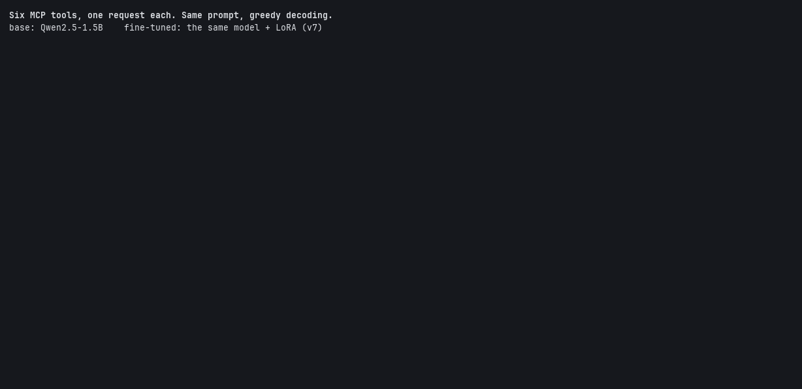

# toolcall-ft

[](https://github.com/Simon-oid/toolcall-ft/actions/workflows/ci.yml)
[](https://github.com/Simon-oid/toolcall-ft/actions/workflows/ci.yml)
[](https://github.com/Simon-oid/toolcall-ft/releases)
[](LICENSE)
[](pyproject.toml)

**Can a small open model call MCP tools as reliably as a large one?**
This repository fine-tunes a 1.5B model to call the tools of two real MCP
servers, and judges every call with the same code those servers run.

- **The tools** are those of [cMCP](https://github.com/Simon-oid/cMCP)'s reference servers: `crag-mcp`
  (`crag_search`, `crag_stats`, retrieval over a [cRAG](https://github.com/Simon-oid/cRAG)
  index) and `filesystem-mcp` (`fs_list`, `fs_read`, `fs_stat`, `fs_write`, inside a
  sandbox).
- **The judge** is cMCP's own JSON parser and JSON Schema validator, linked from C
  ([`judge/judge.c`](judge/judge.c)). A call that passes it is a call the server would
  accept. A call that fails it fails for the reason the server would give, such as
  `/limit: minimum` or `/top: additionalProperties`.



## Result

**After LoRA fine-tuning, the 1.5B model makes the right single call as often
as the 7B and a hosted 120B, and knows much better when not to call. On
conversations that chain several calls it gets more hand-written episodes
right than the 7B (0.62 against 0.42 on the blind set), and still fails
nearly four in ten.**

| one request, one call | right call, held-out phrasings | right call, hand-written (2 sets) | abstains when it should, held-out |
|---|---|---|---|
| Qwen2.5-1.5B base | 0.70 [0.63, 0.76] | 0.69 · 0.84 | 0.55 |
| Qwen2.5-7B base | 0.90 [0.86, 0.94] | 0.87 · 0.91 | 0.60 |
| gpt-oss-120b, hosted, reasoning low | 0.89 [0.84, 0.93] | 0.95 · 0.88 | 0.79 [0.71, 0.87] |
| 1.5B + LoRA, v2 | 0.92 ± 0.05 | 0.97 ± 0.01 · 0.91 ± 0.00 | 0.97 ± 0.04 |
| v3 | **0.96 ± 0.01** | 0.95 ± 0.03 · 0.92 ± 0.05 | 0.94 ± 0.04 |
| v4 | 0.95 ± 0.01 | 0.91 ± 0.03 · 0.96 ± 0.02 | 0.99 ± 0.01 |
| v5 (+ multi-step) | 0.94 ± 0.04 | 0.93 ± 0.04 · 0.96 ± 0.05 | **1.00 ± 0.01** |
| v6 (+ grounded replies) | 0.94 ± 0.03 | 0.96 ± 0.02 · **0.99 ± 0.02** | 0.98 ± 0.01 |
| **v7** (+ rarer episode shapes), the default | 0.96 ± 0.02 | **0.98 ± 0.01** · 0.93 ± 0.02 | 0.96 ± 0.01 |
| v8 (+ retry after a miss) | **0.97 ± 0.01** | 0.94 ± 0.02 · 0.92 ± 0.02 | 0.96 ± 0.01 |

| episodes right (several turns) | generated, held-out phrasings | by hand, set 1 (32 episodes) | by hand, set 2 (30) | by hand, set 3 (43) | by hand, set 4 (48, blind) |
|---|---|---|---|---|---|
| Qwen2.5-1.5B base | 0.27 | 0.22 | 0.23 | 0.30 | 0.21 |
| Qwen2.5-7B base | 0.66 | 0.44 | 0.47 | 0.42 | 0.29 |
| v4 (single-turn only) | 0.35 ± 0.03 | 0.25 ± 0.03 | | | |
| v5 | **0.90 ± 0.03** | 0.40 ± 0.07 | 0.47 ± 0.03 | | |
| v6 | 0.86 ± 0.02 | 0.45 ± 0.08 | 0.44 ± 0.04 | 0.48 ± 0.07 | |
| **v7**, the default | 0.84 ± 0.06 | **0.59 ± 0.05** | **0.56 ± 0.02** | 0.62 ± 0.01 | 0.56 ± 0.03 |
| v8 | 0.84 ± 0.00 | 0.58 ± 0.02 | 0.52 ± 0.02 | **0.65 ± 0.00** | **0.61 ± 0.07** |

How these were measured:
- the Qwen models run as GGUF on llama.cpp, free greedy decoding;
- gpt-oss-120b runs on Groq's free tier with native tool calling, temperature
  0, `reasoning_effort: low`, graded by the same scorer and C judge
  ([below](#a-hosted-120b-baseline));
- "± sd" is across three training seeds; the intervals are 95% bootstrap;
- the hand-written single-turn sets have 54 and 48 cases, so their intervals
  are wide; episodes are scored one turn at a time with the right history.

**What it found.**
- **Fine-tuning closes the gap on single calls.** Right calls on held-out
  phrasings go from 0.70 to 0.96, level with the 7B and the 120B, and the
  model abstains on 0.96 of the requests that need no tool, against 0.60 and
  0.79 for them.
- **Generated tests overstate the gain.** v6 got 0.86 of the generated
  episodes right and 0.44 of the hand-written ones, where the 7B is; v7 gets
  0.84 and 0.62. The model learns the generator's style, which is why the
  hand-written sets exist.
- **Data aimed at the failures moved hand-written episodes, but not past
  them.** v7 adds episode shapes the generator never made (long chains,
  read-edit-write, paging, corrections), and episodes right rise by
  0.12–0.14 on all three hand-written sets. On shapes nobody wrote data for
  it moves 0.49 → 0.56.
- **Teaching one move cost its opposite.** v8 adds episodes that retry after
  a miss, each with a twin where the history already answers. On a new blind
  set, retry episodes go 0.51 → 0.68, but the twins stay at 0.50 and
  abstention drops on every hand-written episode set: the model calls once
  more where it should reply. v7 stays the default.
- **The data decides the behaviour, and each fix moves something else.** v3's
  extra calls cost abstention on ambiguous requests; v4's caution cost a
  little precision; v5 learned the generator's terse final replies, and v6
  fixed those by changing the targets; v7 learned to read before editing,
  and now reads first even when the whole new content is dictated.
- **A grammar guarantees the form, not the content.** llama.cpp's
  schema-derived grammar dropped `limit` from 20 of the 7B's 24 line-range
  reads, and constraining the whole reply removed the choice not to call.
- **Preference tuning set the call rate by its mix of pairs.** Over three DPO
  rounds, final-reply pairs made the model reply instead of calling, call
  pairs made it call everywhere, and abstain pairs made it stop calling. None
  beat v6 ([below](#preference-tuning-three-dpo-rounds)).
- **It still answers from documents.** On [askdocs](https://github.com/Simon-oid/askdocs)' eval no
  version regresses against the base, and v6 and v7 rarely refuse an
  answerable question (0.02 and 0.07, base 0.21).

Every number comes from a committed run, with its hardware and date. The
version-by-version record, with paired tests and failures, is in
[`docs/results.md`](docs/results.md).

## How a call is scored

Each level counts only if the ones before it passed:

| Level | Passes when | Decided by |
|---|---|---|
| 1 json | the call parses to `{"name": string, "arguments": object}` | cMCP's parser (C) |
| 2 schema | the tool exists and its arguments pass the tool's `inputSchema` | cMCP's validator (C) |
| 3 tool | it is the tool the request needs | the expected call |
| 4 args | every argument matches, and none is added | the expected call |

Level 4 is "the call is right".

**How arguments are matched.** Each case says how:
- `exact` by default, where `1`, `1.0` and `true` are all different, since the
  schema says integer;
- `any_of` for equivalent forms (`notes`, `notes/`, `./notes`; the server takes
  all three);
- `contains_all` for free text. A search query has no single right spelling,
  but it must carry the words the user asked about.

**Optional arguments.** An argument the request leaves to the server's default
(`k` for search, `offset` for "the first 20 lines") may be omitted, but not
given a wrong value.

**Requests that need no call** are scored on whether the model abstains:
- a general question (`no_tool`);
- an operation no tool does, like delete or email (`unsupported`);
- a request missing what the tool needs, like "Read the file." (`ambiguous`),
  where the right move is to ask.

**Episodes** ([`src/toolcall/episodes.py`](src/toolcall/episodes.py)) are
conversations of several turns: find a file then read it, check the index then
search, "how big is it?" after a read. Each tool result is rendered in the real
server's format, and a test checks 60 episodes byte for byte against
`filesystem-mcp`. A call turn is scored on the four levels. A final turn must
make no call, and its reply must carry the value the tool returned. An episode
is right only if every turn is. v7's rarer shapes come from a second
generator, [`src/toolcall/rare.py`](src/toolcall/rare.py): folders inside
folders, a retry after a miss, a dead-end search, stopping when the history
already answers, read-edit-write, paging through a log, a user who corrects
the last call; 80 of its episodes are checked against `filesystem-mcp` too.
v8's come from a third, [`src/toolcall/retry.py`](src/toolcall/retry.py):
retrying after a miss (list the folder, list the one subfolder, search with a
name from the conversation, search instead of guessing a file name), each
next to a twin in which the history already answers and the right move is to
reply.

## The dataset

Generated from intents × phrasing families × slot values, with a fixed seed
([`src/toolcall/data.py`](src/toolcall/data.py)):

| Split | Cases | Phrasing | Slot values (files, folders, topics, contents) |
|---|---|---|---|
| train | 1527 (v1) → 1967 (v4) | families 0–5 | train pools |
| val | 153 | families 0–5 | train pools |
| test_id | 180 | families 0–5 | test pools, never seen in training |
| test_ood | 294 (189 calls, 105 no-call) | families 6–7, held out | test pools |
| mt_train, mt_val: episode turns, v5 on | 1409, 155 | families 0–5 | train pools |
| mt_test_id, mt_test_ood: episode turns | 270, 452 | 0–5; held out | test pools |
| mt7_train, mt7_val: rarer episode turns, v7 | 1756, 187 | `rare.py`'s own | train pools |
| mt7_test_id, mt7_test_ood | 334, 558 | own; held out | test pools |
| mt8_train, mt8_val: retry and stop turns, v8 | 1536, 195 | `retry.py`'s own | train pools |
| mt8_test_id, mt8_test_ood | 297, 514 | own; held out | test pools |

`test_id` asks whether the model learned the task or memorised the names.
`test_ood` asks whether it learned the task or memorised the phrasings. Each
version's additions come from their own random stream, so every test case
stays byte-identical across versions.

There are 9 intents (6 tools and 3 kinds of no-call), all present in every
split. The expected call is built from the slots, so it is right by
construction. The tests check it anyway:
- every training call passes cMCP's validator and scores 4/4 against its own
  case;
- no test request or test value appears in training;
- a sample of the `fs_*` calls runs on the real `filesystem-mcp` over a
  fixture tree without a tool error.

Training targets for calls use Qwen 2.5's `<tool_call>` markup. For no-call
cases they are:
- **`unsupported`:** a sentence saying which operation no tool does (four
  wordings since v2);
- **`ambiguous`:** a clarifying question (four wordings since v2);
- **`no_tool`:** the base model's own answer, generated before training, so
  training teaches *when* to call without rewriting how the model talks.

**Hand-written sets.** Generated tests share the generator's style, so nine
sets were written by hand: [`test_hand`](data/test_hand.jsonl) to
[`test_hand5`](data/test_hand5.txt) (54, 48, 48, 40 and 39 single requests),
and [`test_hand6`](data/test_hand6.txt) to [`test_hand9`](data/test_hand9.txt)
(32, 30, 43 and 48 episodes). From `test_hand2` on, each was committed before the
version it measures was trained; `test_hand8` and `test_hand9` also before the
generator of v7's and v8's data. `test_hand5` to `test_hand9` were written from a brief by someone
who had not seen the generator, and they are the numbers to quote. [`KNOWN_LIMITATIONS.md`](KNOWN_LIMITATIONS.md#the-test-sets)
says which sets stopped being blind, and why.

## Baselines

All models run through a llama.cpp server on the same machine (RX 7800 XT,
llama.cpp `a4d4f2f`, 2026-11-10). The prompt is rendered by the model's own
chat template with the six tools, and decoding is greedy. Each server has one
slot and gets one request at a time: two identical runs over the 474 test
cases gave **0** different replies, so a difference between rows is the
model, not noise. Full table with intervals:
[`results/summary.md`](results/summary.md).

The three decodings:
- **free:** the raw reply, judged as written;
- **eager:** the whole reply constrained to "a valid call or `{"name": "none"}`";
- **lazy:** llama.cpp's own tool path, a grammar built from the tools' schemas
  and applied only once the model starts a call.

| test_ood (189 need a call, 105 need none) | right call (L4) [95% CI] | abstains when it should | call/no-call decision |
|---|---|---|---|
| Qwen2.5-1.5B Q8_0, free | 0.70 [0.63, 0.76] | 0.55 | 0.84 |
| Qwen2.5-1.5B, eager | 0.69 | **0.00** | 0.64 |
| Qwen2.5-1.5B, lazy | 0.68 | 0.55 | 0.83 |
| Qwen2.5-3B Q4_K_M, free | 0.70 [0.64, 0.77] | 0.60 | 0.81 |
| Qwen2.5-7B Q4_K_M, free | **0.90** [0.86, 0.94] | 0.60 | 0.83 |
| Qwen2.5-7B, lazy | 0.84 [0.78, 0.89] | 0.61 | 0.83 |
| gpt-oss-120b, hosted API, reasoning low | 0.89 [0.84, 0.93] | 0.79 | 0.92 |

- **The gap to close.** On held-out phrasings the 7B gets 90% of calls right
  and the 1.5B 70%, with the intervals well apart. The 3B is no better than
  the 1.5B.
- **Constraining all output removes the choice not to call.** With the whole
  reply forced into JSON, the model never chose `none`: abstention went from
  0.55 to 0.00. Once a JSON object has started, it always goes on with a tool
  name.
- **A grammar can drop arguments silently.** The grammar llama.cpp derives
  from a schema fixes the key order: required first, then optional in schema
  order (`limit` before `offset`). The 7B writes `offset` and then `limit`;
  after `offset` the grammar no longer allows `limit`, and the object closes.
  On the 24 requests for a line range the 7B got **22** right free and **4**
  right lazy. Every one of those calls is valid (level 2) and wrong (level
  4): it reads to the end of the file instead of the lines asked for.
- **Constrained decoding does not choose the tool or the values.** At levels
  3–4 the lazy grammar is within the noise of free decoding at best. The
  fine-tuning has to win there.
- **Abstention is weak for every model, and differs by kind.** The 1.5B
  makes a call on 60% of plain chit-chat (`no_tool`). The 7B makes a call on
  55% of requests for an operation no tool does (`unsupported`).

### A hosted 120B baseline

`python -m toolcall.evaluate --api-model openai/gpt-oss-120b --reasoning-effort low`
(key in `$TOOLCALL_API_KEY`, never a flag) sends each case to an
OpenAI-compatible API with the six tools as native `tools`
([`src/toolcall/api_backend.py`](src/toolcall/api_backend.py)). It spent 13.7
reasoning tokens per request on average. It is a different runtime as well as
a different model, so read the gap to the local rows as both. Its failures on
test_ood, by kind:

- **Right call: a tie, and most misses are a convention.** 9 of its 11 wrong
  arguments are `k: 10` on `crag_search` where the request asked for no count
  and the test expects the default 5. Counting those right gives 0.94, level
  with the fine-tuned 1.5B. The fine-tuned model learned the dataset's
  conventions; the 120B did not see them.
- **Abstention: a real gap.** It calls a tool in 22 of the 105 requests it
  should refuse (fine-tuned v2: 1 to 9 across seeds). Most are first steps
  toward a task the tools cannot finish ("translate and save" → `fs_read`).
  Four are worse: "erase this file", with no delete tool, becomes `fs_write`
  with empty content, which truncates the file.
- 2 of 474 calls were rejected by the provider as invalid (a tool not in the
  request); they are scored from the raw generation, as wrong calls.

## Fine-tuning

**The recipe** ([`src/toolcall/train.py`](src/toolcall/train.py)):
- Qwen2.5-1.5B-Instruct, LoRA r=16 (α 32) on all linear layers, bf16.
- 2 epochs, effective batch 16, lr 2e-4 cosine: 192 steps in 26 minutes on
  the RX 7800 XT for v1, 422 steps in 63 minutes for v5, 642 in 98 minutes
  for v7, 834 in 129 minutes for v8.
- The prompt is rendered exactly as at evaluation, and the loss is on the
  completion only.
- Three training seeds from v2 on, the same three for every version, compared
  seed by seed ([`scripts/pooled.py`](scripts/pooled.py)).

**Serving it.** The adapter is merged into the weights and converted with
llama.cpp's own converter to Q8_0, the base model's quantization
([`src/toolcall/export.py`](src/toolcall/export.py)). It is then served and
evaluated exactly like the baselines.

**Version by version.** Each version changes only the training data, aimed at
the failures of the one before. Details and paired tests are in
[`docs/results.md`](docs/results.md).

| version | added to the training data | what it fixed | what it cost |
|---|---|---|---|
| v1 | 1527 single requests | right call on test_ood 0.70 → 0.91 (43 fixed, 3 broken); abstention 0.55 → 0.92 | the fixed refusal sentence leaks onto real requests |
| v2 | four wordings per refusal and question; 160 line-range reads | abstention 0.92 → 0.99 (7 fixed, 0 broken); `crag_stats` 8 → 14 of 14 | nothing measurable |
| v3 | 80 bare-folder listings, 60 searches with a trailing instruction | right call 0.92 → 0.96 (29 / 6); blind test_hand3 0.89 → 0.97 | abstention 0.97 → 0.94 on ambiguous requests |
| v4 | 140 ambiguous requests answered with a question | abstention 0.94 → 0.99; independent test_hand5 0.80 → 0.89 | right call 0.96 → 0.95: details dropped on clear requests |
| v5 | 1409 episode turns, ten kinds | episodes right: generated 0.35 → 0.90, test_hand6 0.25 → 0.40; calls inside an episode 0.36 → 0.68 | final replies leave out the value the user asked for |
| v6 | final replies that carry the value (231 episodes change) | value in the final reply: generated 0.51 → 1.00, blind test_hand7 0.59 → 0.68 | episodes on test_hand7 0.47 → 0.44 |
| v7 | 1756 episode turns in twelve rarer shapes (`rare.py`) | episodes right: blind test_hand8 0.48 → 0.62 (25 fixed, 7 broken), test_hand7 0.44 → 0.56, test_hand6 0.45 → 0.59 | v5's generated episodes 0.86 → 0.84; "replace the contents of keys.txt with: rotated" read instead of written; askdocs wrong refusals 0.02 → 0.07 |
| v8 | 1536 retry and stop turns (`retry.py`) | blind test_hand9: retry episodes 0.51 → 0.68, episodes right 0.56 → 0.61 (16 fixed, 8 broken), calls right 0.80 → 0.87 | abstention on all four hand-written episode sets (10 fixed, 27 broken); stop twins unchanged; shorter searches on single requests (test_hand 0.98 → 0.94) |

**Why v7 is the default.** It raises whole hand-written episodes on all three
sets and in every seed, by 0.12–0.14 where v6 and DPO moved them by at most
0.06, and it is above the 7B on the blind one; single-turn calls hold
(test_ood 0.94 → 0.96). What it costs is small and mostly within the seeds'
noise: two points on v5's generated episodes and on abstention, a slip on
askdocs against v6 (still ahead of the base), and one new habit from its
read-edit-write episodes: told to replace a file's contents with a dictated
line, it reads the file first, in all three seeds. v6's "archive exists and is
empty." after a stat is gone. Analysis:
[`results/compare-v6-v7/NOTES.md`](results/compare-v6-v7/NOTES.md).

**Why v8 is not.** It is the first version that learns some of the retry
after a miss, which no earlier model did, but the gain is on one set and in
no seed significant alone, while it gives back abstention on every
hand-written episode set: where the history already holds the answer
(`error_already_seen`, a listing that settles the question) it calls once
more. Its stop twins, meant to prevent that, are right no more often than
v7's. It also copies `retry.py`'s bare-topic searches, dropping `k` and the
second half of "X and Y" requests. Analysis:
[`results/compare-v7-v8/NOTES.md`](results/compare-v7-v8/NOTES.md).

## Preference tuning: three DPO rounds

v6 fixed v5's final replies by retraining. The same fix was also tried with
DPO from v5 ([`prefs.py`](src/toolcall/prefs.py),
[`dpo.py`](src/toolcall/dpo.py): TRL's DPOTrainer, beta 0.1, with v5 itself
as the reference). The pairs are on-policy: the rejected side is what a model
actually said.

| round | pairs per seed (chosen over rejected) |
|---|---|
| 1 | 231 final replies: the grounded reply over v5's own |
| 2 | + 181, 189, 24 call turns: the right call over a sampled mistake of round 1 ([`sample.py`](src/toolcall/sample.py)) |
| 3 | + 505, 565, 99 no-call turns: the training reply over an unneeded call sampled from round 2 |

| 3 seeds, mean | v5 | v6 | DPO 1 | DPO 2 | DPO 3 |
|---|---|---|---|---|---|
| abstains when it should, test_ood | **1.00** | 0.98 | **1.00** | 0.30 | 0.98 |
| right call inside an episode, generated | **0.91** | 0.87 | 0.84 | 0.90 | 0.43 |
| right call inside an episode, test_hand7 | **0.69** | 0.64 | 0.64 | 0.68 | 0.30 |
| final reply carries the value, test_hand7 | 0.59 | 0.68 | **0.73** | 0.52 | 0.70 |
| episodes right, test_hand7 | 0.47 | 0.44 | **0.50** | 0.30 | 0.33 |

- **Each round moved the turns its pairs touched, and nothing held the
  rest.** Round 1 gave the best final replies on the blind set, and replied
  instead of calling early in the same kinds of episode ("I can do that once
  I know more…"). Round 2 brought the calls back, and in one seed called
  `crag_search` on 99 of 105 requests that need no tool ("What does CPU stand
  for?"). Round 3 brought abstention back and stopped calling: one seed
  answers "Run a retrieval on the soak test, please." with "Happy to help.
  What should I look up?".
- **The damage tracks the mix.** Round 2's abstention per seed is 0.06,
  0.02 and 0.82, in the order of its call pairs (181, 189, 24). Round 3's
  calls inside generated episodes are 0.59, 0.68 and 0.02 per seed, in the
  order of its abstain-to-call ratio (2.8, 3.0, 4.1).
- **So the ratio is a knob,** and tuning it until the test sets look right
  would fit it to them. SFT on whole episodes (v6) has no such knob.

Per-seed tables and paired tests are in
[`results/compare-v5-v6-dpo/`](results/compare-v5-v6-dpo/),
[`results/compare-dpo2/`](results/compare-dpo2/) and
[`results/compare-dpo3/`](results/compare-dpo3/).

### GRPO from v7, with the metric as reward

[`grpo.py`](src/toolcall/grpo.py) runs TRL's GRPOTrainer from v7 (KL to
v7, 8 replies per prompt). The reward is the evaluation's scorer and C
judge: 1 for a right step, 0.5 for a call that passes the schema but is
wrong, 0 otherwise.

- **On its own training data v7 leaves almost nothing to learn.** In a
  smoke over all 5132 training turns, 47 of 48 groups had 8 replies with
  the same reward, which gives GRPO no gradient. A full epoch would be
  ~12 GPU hours for about a hundred useful prompts.
- **So it trains only on the turns v7 gets wrong when sampled** (4
  samples at temperature 1, `sample.py --all`): 67, 78 and 60 turns per
  seed, 1.2–1.5% of the data, mostly listing-then-stat. That is 16–20
  steps, under 25 minutes a seed.
- **Result: within noise of v7 on every set, and nothing breaks.**
  `test_hand8` episodes 0.62 → 0.65 (4 fixed, 0 broken over three seeds,
  a different episode in each; the set is no longer blind), test_ood
  unchanged, askdocs unchanged. Retry after a miss stays at 0: v7 does
  not fail it on its training data, so no reward ever separates the
  replies there. v7 stays the default.
  [`results/compare-v7-grpo/NOTES.md`](results/compare-v7-grpo/NOTES.md).

## Does it still answer questions?

Training a model to call tools can cost it its general ability. So each
version answered [askdocs](https://github.com/Simon-oid/askdocs)' 53
evaluation questions (43 answerable, 10 to refuse), which need grounded,
cited answers and no tool calls, with the same retrieval, and a 7B judged
faithfulness. These runs share one
askdocs version and one base run, seed 0 of each model, 2026-11-22 to 11-28
([`results/askdocs-forgetting-v6/`](results/askdocs-forgetting-v6/),
[`results/askdocs-forgetting-v7/`](results/askdocs-forgetting-v7/),
[`results/askdocs-forgetting-v8/`](results/askdocs-forgetting-v8/)):

| askdocs eval | base 1.5B | v5 | v6 | DPO 1 | DPO 2 | DPO 3 | **v7** | v8 |
|---|---|---|---|---|---|---|---|---|
| key-fact recall | 0.49 | 0.55 | 0.66 | 0.56 | 0.53 | **0.70** | 0.62 | 0.53 |
| wrong refusals | 0.21 | 0.16 | **0.02** | 0.19 | 0.16 | 0.05 | 0.07 | **0.02** |
| faithfulness | 0.79 | **0.89** | 0.85 | 0.72 | 0.88 | 0.81 | 0.75 | 0.73 |

askdocs' regression gate flags no version. v6 recalls more key facts than
the base (+0.17 [+0.05, +0.31]) and refuses 1 answerable question in 43;
v7 recalls +0.13 [+0.02, +0.25] over the base, refuses 3 in 43, and answers
one of the 10 it should refuse; v8 refuses 1 in 43 and all 10 it should. DPO 3 recalls the most, a side effect of
calling less. Earlier versions were
measured with an older askdocs and are not comparable to this table; they
are in [`docs/results.md`](docs/results.md#answering-documents-askdocs). With
one seed per version, these are signals, not measurements.

**As askdocs' answering model** the fine-tuned 1.5B is no replacement for
the 3B askdocs uses by default. In the run with v2 it was a third faster
(445 against 686 ms P50) and much worse at citing (faithfulness 0.12
against 0.60), like the base 1.5B. What the fine-tuning bought is tool
calling.

## Limits

Three training seeds for v2 to v8, for DPO and for GRPO, one for v1; askdocs on one
seed of each. Six fixed tools, English only. Episodes are scored with the
right history before each turn, so a model that recovers from its own
mistake is never tested. The hand-written sets are small: test_hand7 has 27
final turns with a value to report, too few for one seed's change to be
significant, and `test_hand8`'s eight families have 2–3 episodes each. [`KNOWN_LIMITATIONS.md`](KNOWN_LIMITATIONS.md) has the full
list, and [`docs/architecture.md`](docs/architecture.md) the design
decisions behind the measurement.

## Training on an AMD GPU

[`scripts/rocm_smoke.py`](scripts/rocm_smoke.py) runs a few LoRA steps to
check that the machine can train before any plan relies on it. Measured on
2026-11-10 (RX 7800 XT 16 GB, ROCm 7.2, PyTorch 2.14.1+rocm7.2):

| | |
|---|---|
| Qwen2.5-1.5B-Instruct, LoRA r=16 on all linear layers, bf16 | loss 0.454 → 0.000 in 40 steps |
| throughput, batch 2 × 512, gradient checkpointing | 2415 tokens/s |
| peak memory | 9.8 GiB |
| same at batch 4 without checkpointing | out of memory |

The out-of-memory case is the logits: a 152k-token vocabulary makes the fp32
logits of 4 × 512 tokens 1.2 GB before their gradient.

llama.cpp on ROCm occasionally returns a reply made of one repeated
character ("!!!!…"). Every committed run was scanned for replies that start
with 16 repeated characters, and the two affected runs were evaluated again.

## Demo

[`scripts/demo.py`](scripts/demo.py) sends five hand-written requests to the
base model and to the fine-tuned one, side by side, and prints each call
with the validator's verdict (the recording at the top). In one run the base
model miscounted a line range (`limit 15` for lines 30 to 45), passed an
argument `crag_stats` does not take, and called a tool that does not exist
(`fs_delete`). The fine-tuned model got all five right.

## Run it

```sh
make -C ../cMCP && make -C judge          # cMCP (sibling checkout) and the judge
python -m venv .venv && .venv/bin/pip install -e '.[dev]'
scripts/snapshot_tools.sh                 # data/tools.json from the live servers
.venv/bin/python -m toolcall.data         # data/*.jsonl
.venv/bin/pytest -q
```

For training, install the PyTorch build for your GPU, then
`pip install -e '.[train]'`. The training, export, evaluation and DPO
commands are in [`docs/architecture.md`](docs/architecture.md#reproducing).

## License

MIT
